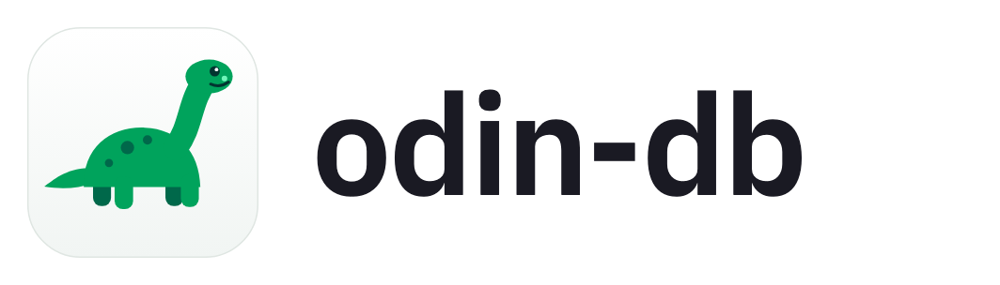

<p align="center">
  <picture>
    <source media="(prefers-color-scheme: dark)" srcset="branding/logo-dark.png">
    
  </picture>
</p>

# odin-db

Open source desktop client for MongoDB. A free alternative to Studio 3T, built with Tauri 2 (Rust) and React.

> **Status: early releases.** Installers ship for every platform and update themselves. Every feature is covered by tests against MongoDB 6.0, 7.0 and 8.0, but the project is young: keep backups of data you care about, and use read-only connections for production.

## Features

- **Connections**: connection string or form (SRV, TLS with certificate files, SCRAM, X.509, LDAP, AWS and OIDC authentication, replica sets), passwords in the OS keychain, SSH tunnels through a bastion (host keys pinned), read-only profiles enforced in the backend, a color per connection on its tree, tabs and collections, a connection manager (⌘O / Ctrl+O), folders, import and export of connections (also from MongoDB Compass), live status when a server stops answering.
- **Queries**: filter, sort and projection editors that suggest fields, operators, BSON constructors and values; collation, hint and time limit; saved and recent queries; Explain with a visual plan and index suggestions; a visual filter builder; SQL SELECT translated to MongoDB; Query Code turns a query or pipeline into mongosh, Node.js, Python, Java, C# or Go.
- **Results**: a fast virtualized table (resize, pin, hide and sort columns, step into nested fields, edit a value in place, filter by a value, distinct values), expandable document trees, a JSON view and quick charts (lines over time, bars, histograms, scatter plots, points on a map); edit documents in mongosh syntax that keeps every BSON type; update, delete, rename, convert or remove a field across the documents matching a filter, with Undo.
- **AI query assistant** (optional): describe the documents in plain language and a small model writes the find query, shown for review before it runs. Models run offline inside the app or in your Ollama; only field names and types reach the model, never your data.
- **Aggregation builder**: stages with live previews and suggestions from the previous stage's output, Explain, saved pipelines, a text mode, and creating a view from the pipeline.
- **Collections**: schema analysis (of a filter's documents too), validation rules with a `$jsonSchema` generated from the documents and a search for documents breaking them, indexes (usage, unused ones flagged, hide before dropping, TTL, partial, collation, builds in progress), capped, time series and clustered collections, views, live changes, GridFS files, and creating, renaming and dropping databases and collections.
- **Data movement**: JSON and CSV import and export of collections and whole databases; copy collections and databases between connections; compare two collections document by document and sync the differences; compare two databases' schema and indexes; backup and restore with the bundled mongodump and mongorestore, scheduled backups with retention and history; search a value across every collection.
- **Database diagram**: collections and the references between them, inferred from the data, with notes and areas; copy as Mermaid or save as an image.
- **Shell**: the real mongosh in a tab, downloaded and verified on request.
- **Users and roles**: users with their roles, generated passwords, custom roles with their privileges.
- **Server monitor**: operations per second, connections, network and memory, replica set members and lag, sharding, the busiest collections, running operations with a kill button, an index advisor from the server's slow operations, and a query profiler.
- **Everywhere**: command palette (⌘K / Ctrl+K), customizable keyboard shortcuts, light and dark themes, English and Italian, automatic updates, accessible (WCAG 2.2 AA contrast, full keyboard use), Windows, macOS and Linux.

## Installing

Installers for macOS (Apple silicon and Intel), Windows and Linux (AppImage, deb, rpm) are attached to each [release](https://github.com/matteohcf/odin-db/releases), with `SHA256SUMS.txt` to check a download. mongodump and mongorestore are included. The shell uses your installed [mongosh](https://www.mongodb.com/try/download/shell), or downloads and verifies it in one click. Once installed, the app offers new versions itself (signed updates, nothing installs without a click).

Early builds are not code-signed yet:

- **macOS**: the first time, right-click the app and choose **Open**, or run `xattr -dr com.apple.quarantine /Applications/odin-db.app`.
- **Windows**: SmartScreen may warn about an unknown publisher; choose **More info → Run anyway**.

## Principles

- Data correctness first: BSON types never change silently ([ADR-0007](docs/adr/0007-bson-representation.md)).
- Credentials live in the OS keyring, never in files or logs ([ADR-0017](docs/adr/0017-security-model.md)).
- No telemetry ([ADR-0023](docs/adr/0023-logging-no-telemetry.md)).
- Every architectural decision is recorded in [`docs/adr`](docs/adr/README.md).

## Development

Prerequisites: Node.js 22+, pnpm 10, Rust via [rustup](https://rustup.rs) (the toolchain is pinned in `rust-toolchain.toml`) and the [Tauri system dependencies](https://tauri.app/start/prerequisites/) for your OS, plus CMake for llama.cpp.

```sh
pnpm install
pnpm dev        # run the desktop app
pnpm check      # all lint, type and test gates (same as CI)
```

See [CONTRIBUTING.md](CONTRIBUTING.md) for the workflow and [CLAUDE.md](CLAUDE.md) for architecture rules.

## License

Licensed under either of [Apache License 2.0](LICENSE-APACHE) or [MIT license](LICENSE-MIT), at your option. MongoDB is a trademark of MongoDB, Inc.; odin-db is not affiliated with MongoDB, Inc.
